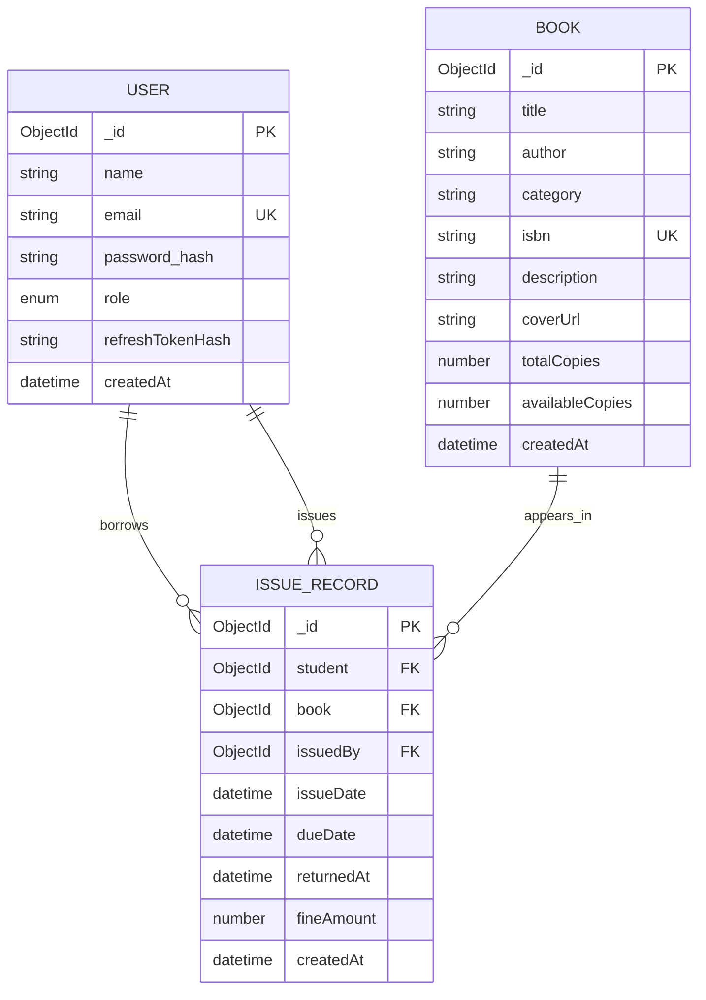

# CampusLibrary data model

`IssueRecord.student` and `IssueRecord.issuedBy` both reference `User`; `IssueRecord.book` references `Book`. A null `returnedAt` means the loan is active. The book's `availableCopies` count is updated when a loan is issued or returned. Indexes support book search/filtering and active-loan / due-date queries.

The app uses the `users`, `books`, and `issues` collections inside its dedicated `campuslibrary` database.
